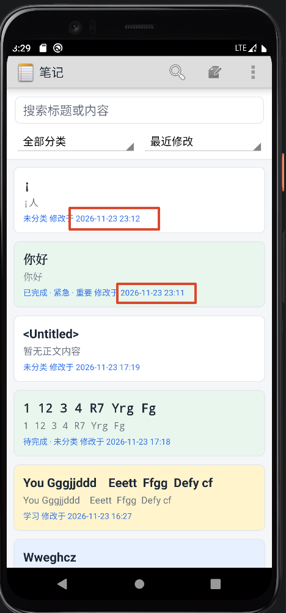
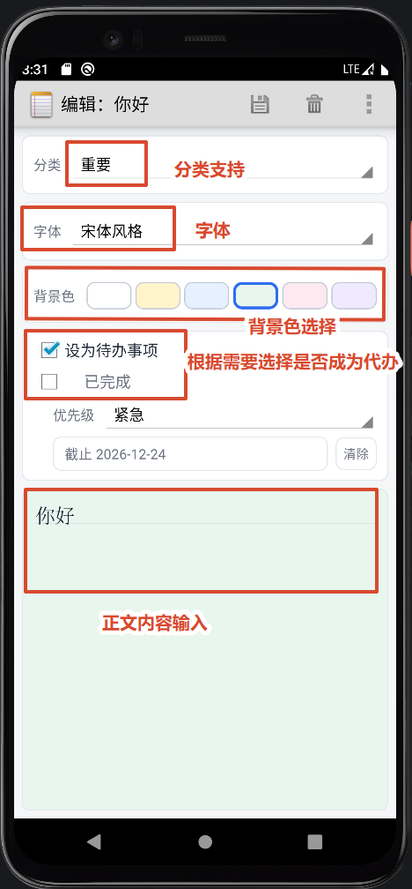
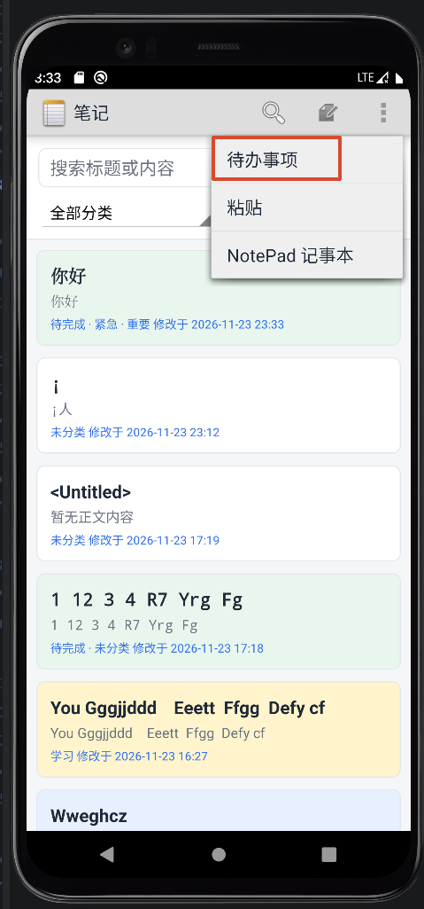
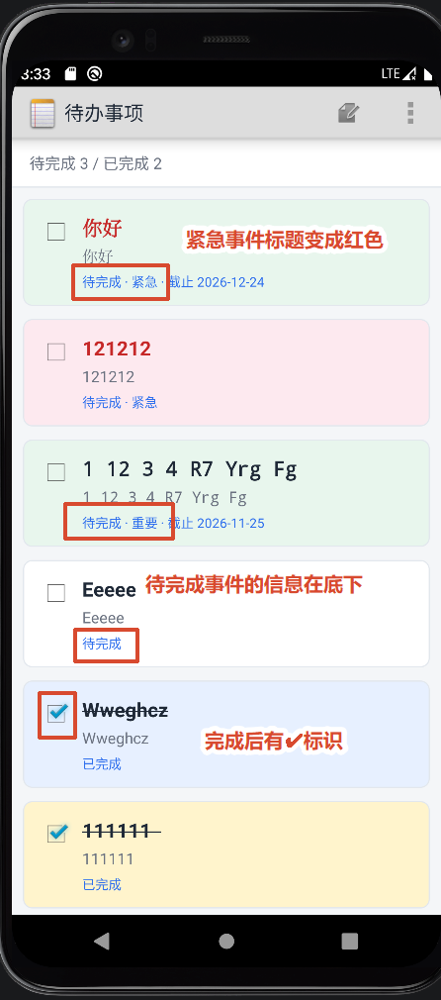
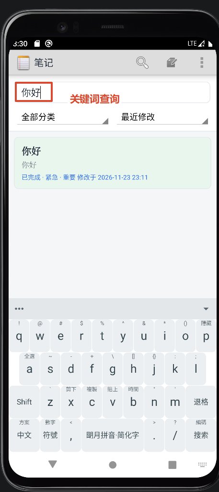
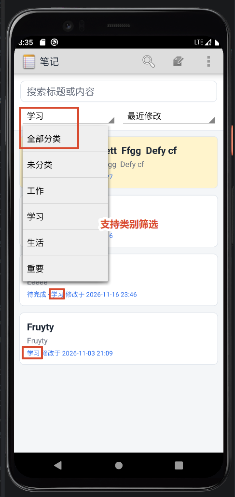
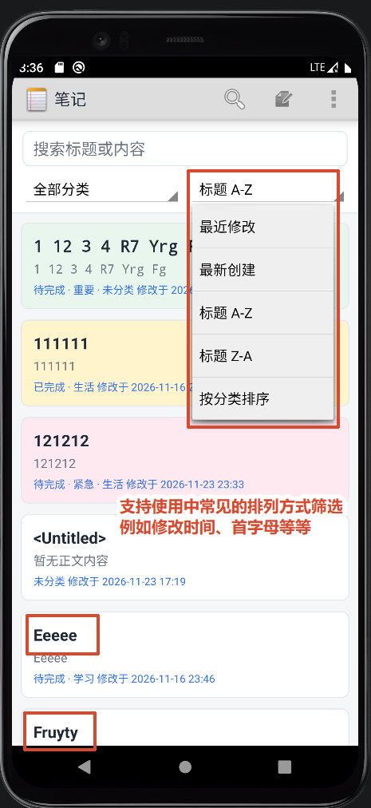
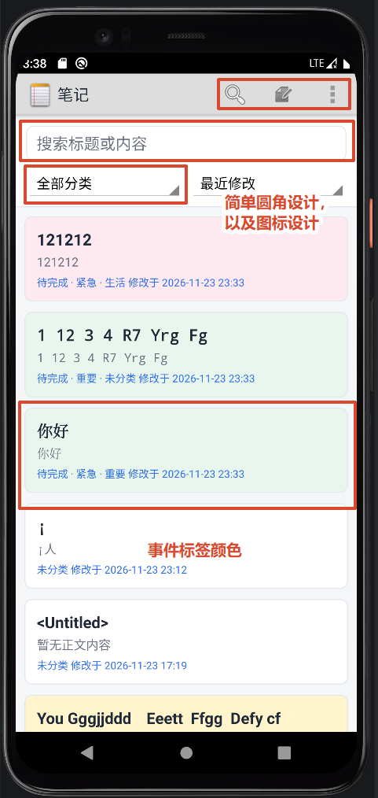

# NotePad 记事本 Android 期中项目

## 项目简介

本项目基于 Android 官方早期 NotePad 示例进行功能扩展，保留
`ListActivity + ContentProvider + SQLite` 的经典架构，在已有笔记增删改查基础上完成时间戳、组合查询、分类、排序、待办、背景色、字体和 UI 优化。

项目重点不只是增加按钮，而是让新增字段贯穿数据库、ContentProvider、编辑器、笔记列表和待办列表，形成完整的数据闭环。

主要技术栈：

- Java
- Android SDK
- ListActivity
- ContentProvider
- SQLite / SQLiteOpenHelper
- CursorAdapter / SimpleCursorAdapter
- GradientDrawable
- Gradle

## 功能总览

| 类型 | 功能 | 实现情况 |
| --- | --- | --- |
| 基本要求 | 列表显示最后修改时间 | 已完成 |
| 基本要求 | 按标题或正文查询 | 已完成 |
| 扩展功能 | 笔记分类与分类筛选 | 已完成 |
| 扩展功能 | 待办事项管理 | 已完成 |
| 扩展功能 | 五种笔记排序 | 已完成 |
| 扩展功能 | UI 美化与逐笔记背景色 | 已完成 |
| 增强功能 | 笔记置顶 | 已完成 |
| 增强功能 | 待办优先级、截止日期、逾期提示 | 已完成 |
| 增强功能 | 待办完成数量统计 | 已完成 |
| 增强功能 | 每条笔记独立字体 | 已完成 |
| 数据能力 | 数据库从版本 2 升级到版本 6 | 已完成 |

所有功能截图保存在 `screenshot` 文件夹。

## 一、笔记时间戳

笔记列表的每一项都会显示最后修改时间。新增笔记、修改正文、切换分类、修改待办状态、选择背景色或改变字体后，列表中的 `modified` 时间会更新，并按当前排序规则重新排列。

时间统一使用中国上海时区 `Asia/Shanghai`，避免模拟器、电脑和真实设备时区不同导致显示时间不一致。



关键代码位于 `NoteDateUtils` 和 `NotesList`：

```java
// 全项目固定使用中国上海时区，避免不同设备显示不同时间
private static final TimeZone SHANGHAI =
        TimeZone.getTimeZone("Asia/Shanghai");

static SimpleDateFormat formatter(String pattern) {
    //统一创建格式器，业务代码只传日期格式即可
    SimpleDateFormat formatter = new SimpleDateFormat(
            pattern,
            Locale.getDefault());
    //真正把显示时区设置为上海
    formatter.setTimeZone(SHANGHAI);
    return formatter;
}
```

```java
//使用统一格式器
SimpleDateFormat formatter =
        NoteDateUtils.formatter("yyyy-MM-dd HH:mm");
//time会显示在每条笔记底部的“修改于 ...”位置
String time = getString(
        R.string.note_time_format,
        formatter.format(new Date(modified)));
```

数据库中的时间仍然保存为 UTC 毫秒值，因此不会因为显示时区变化而修改原始数据。

## 二、笔记信息编辑

编辑器顶部可以设置：

- 分类：未分类、工作、学习、生活、重要
- 字体：系统默认、宋体风格、黑体风格、等宽字体
- 背景色：白色、黄色、蓝色、绿色、粉色、淡紫色
- 是否为待办事项
- 待办完成状态
- 待办优先级：普通、重要、紧急
- 待办截止日期
- 正文内容



保存时，所有设置会一次性写入 ContentProvider：

```java
//  ContentValues是写入SQLite的数据载体
ContentValues values = new ContentValues();
//空分类统一成“未分类”
values.put(
        NotePad.Notes.COLUMN_NAME_CATEGORY,
        NoteDataUtils.normalizeCategory(
                String.valueOf(mCategory.getSelectedItem())));

//先读取复选框，决定后面待办字段如何保存
boolean isTodo = mIsTodo.isChecked();
values.put(NotePad.Notes.COLUMN_NAME_IS_TODO, isTodo ? 1 : 0);
//不是待办，则默认状态强制为 0
values.put(
        NotePad.Notes.COLUMN_NAME_TODO_DONE,
        isTodo && mTodoDone.isChecked() ? 1 : 0);
//保存优先级索引：普通=0、重要=1、紧急=2
values.put(
        NotePad.Notes.COLUMN_NAME_TODO_PRIORITY,
        isTodo ? mPriority.getSelectedItemPosition() : 0);
//保存截止日期毫秒值；普通笔记不保存截止日期
values.put(
        NotePad.Notes.COLUMN_NAME_TODO_DUE_DATE,
        isTodo ? mSelectedDueDate : 0);
//背景色只保存索引，具体 ARGB 颜色由工具类负责
values.put(
        NotePad.Notes.COLUMN_NAME_BACKGROUND_COLOR,
        NoteColorUtils.normalize(mSelectedColorIndex));
//字体保存样式索引
values.put(
        NotePad.Notes.COLUMN_NAME_FONT_STYLE,
        NoteFontUtils.normalize(mFont.getSelectedItemPosition()));
```

背景色和字体都保存为索引，而不是把颜色值或字体对象直接写入数据库。这样便于以后统一调整配色和字体映射。

字体映射代码：

```java
//字体索引与 Android 系统字体一一对应
private static final Typeface[] TYPEFACES = new Typeface[] {
        Typeface.DEFAULT,     //系统默认
        Typeface.SERIF,       //宋体风格
        Typeface.SANS_SERIF,  //黑体风格
        Typeface.MONOSPACE    //等宽字体
};

static void apply(TextView view, int fontStyle) {
    //normalize可以防止数据库异常值导致数组越界
    view.setTypeface(TYPEFACES[normalize(fontStyle)]);
}
```

## 三、待办事项入口与详情

笔记列表右上角菜单提供“待办事项”入口。待办不是另一套独立数据，而是复用笔记表中的 `is_todo` 字段，因此待办仍支持标题、正文、分类、搜索、排序、颜色和字体。



待办页面具有以下细节：

- 顶部显示“待完成数量 / 已完成数量”
- 未完成事项排在已完成事项之前
- 按优先级和截止日期继续排序
- 紧急且未完成的待办标题显示红色
- 已完成待办显示复选框和删除线
- 已逾期待办显示红色“已逾期”
- 点击复选框可直接切换状态



待办查询和排序代码：

```java
return getContentResolver().query(
        NotePad.Notes.CONTENT_URI,
        PROJECTION,
        NotePad.Notes.COLUMN_NAME_IS_TODO + " = 1", //只查询待办
        null,
        //先按完成状态分组，再按优先级、截止日期和修改时间排序
        NotePad.Notes.COLUMN_NAME_TODO_DONE + " ASC, "
                + NotePad.Notes.COLUMN_NAME_TODO_PRIORITY + " DESC, "
                + "CASE WHEN "
                + NotePad.Notes.COLUMN_NAME_TODO_DUE_DATE
                + " = 0 THEN 1 ELSE 0 END ASC, "
                + NotePad.Notes.COLUMN_NAME_TODO_DUE_DATE + " ASC, "
                + NotePad.Notes.COLUMN_NAME_MODIFICATION_DATE + " DESC");
```

完成状态更新：

```java
private void updateTodo(long noteId, boolean completed) {
    //点击复选框时只更新待办状态和修改时间
    ContentValues values = new ContentValues();
    values.put(
            NotePad.Notes.COLUMN_NAME_TODO_DONE,
            completed ? 1 : 0);
    values.put(
            NotePad.Notes.COLUMN_NAME_MODIFICATION_DATE,
            System.currentTimeMillis());

    Uri noteUri = ContentUris.withAppendedId(
            NotePad.Notes.CONTENT_ID_URI_BASE,
            noteId);
    //只更新当前这一条笔记
    getContentResolver().update(noteUri, values, null, null);
    //重新查询 Cursor，刷新列表排序和顶部统计
    refreshTodos();
}
```

## 四、标题与正文关键词查询

列表顶部提供实时搜索框。输入关键词后，会同时查询：

- 笔记标题
- 笔记正文

搜索结果还可以继续与分类、排序条件组合使用。



查询使用参数化 SQL：

```java
String searchClause = "("
        + NotePad.Notes.COLUMN_NAME_TITLE //先匹配笔记标题
        + " LIKE ? ESCAPE '\\' OR " //? 是占位符，避免拼接用户输入
        + NotePad.Notes.COLUMN_NAME_NOTE //再匹配笔记正文
        + " LIKE ? ESCAPE '\\')"; //标题或正文命中都算搜索结果

selection = selection == null
        ? searchClause //没有分类条件时，直接使用搜索条件
        : selection + " AND " + searchClause; //已有分类时，搜索与分类同时成立

String pattern = "%"
        + NoteDataUtils.escapeLike(search) //先转义特殊字符，避免通配符误匹配
        + "%"; //前后加 %，表示标题或正文包含关键词即可
arguments.add(pattern); //第一个参数用于标题
arguments.add(pattern); //第二个参数用于正文
```

`%` 和 `_` 是 SQLite `LIKE` 的通配符，因此搜索前会进行转义：

```java
static String escapeLike(String value) {
    return value
            .replace("\\", "\\\\") //先转义反斜杠本身
            .replace("%", "\\%") //让百分号按普通字符查询
            .replace("_", "\\_"); //让下划线按普通字符查询
}
```

这样用户输入普通的百分号或下划线时，也能按字面内容查询。

## 五、笔记分类与排序

### 1. 分类筛选

分类支持：

- 全部分类
- 未分类
- 工作
- 学习
- 生活
- 重要

选择分类后，只显示对应笔记，搜索结果也会保留分类条件。



### 2. 五种排序方式



支持以下排序：

- 最近修改
- 最新创建
- 标题 A-Z
- 标题 Z-A
- 按分类排序

无论选择哪种排序，置顶笔记都会排在普通笔记之前。

```java
private String selectedSortOrder() {
    String order; //先保存用户选择的基础排序规则
    switch (mSortOrder.getSelectedItemPosition()) { //下拉框位置就是排序编号
        case 1:
            order = NotePad.Notes.COLUMN_NAME_CREATE_DATE + " DESC"; //最新创建
            break;
        case 2:
            order = NotePad.Notes.COLUMN_NAME_TITLE
                    + " COLLATE NOCASE ASC"; //标题 A-Z，NOCASE 忽略大小写
            break;
        case 3:
            order = NotePad.Notes.COLUMN_NAME_TITLE
                    + " COLLATE NOCASE DESC"; //标题 Z-A
            break;
        case 4:
            order = NotePad.Notes.COLUMN_NAME_CATEGORY + " ASC, "
                    + NotePad.Notes.COLUMN_NAME_MODIFICATION_DATE
                    + " DESC"; //先按分类排，同分类再按最近修改排
            break;
        default:
            order = NotePad.Notes.DEFAULT_SORT_ORDER; //默认最近修改优先
            break;
    }
    return NotePad.Notes.COLUMN_NAME_IS_PINNED + " DESC, " + order; //置顶条件放最前，置顶笔记始终在最上面
}
```

搜索、分类和排序都在数据库查询中组合执行，没有把全部笔记读取到 Java 内存后再过滤。

## 六、UI 美化

UI 优化遵循“清晰、紧凑、适合高频记录”的原则，没有引入复杂第三方 UI 框架。

主要内容：

- 浅色应用背景
- 白色圆角笔记卡片
- 搜索框圆角边框
- 标题、摘要、分类和时间分级显示
- 搜索、分类、排序集中放在列表顶部
- 编辑器按功能分成多个面板
- 六种背景色色块
- 字体和待办设置区域
- 已完成待办删除线
- 逾期和紧急状态使用警示色



背景色由 `GradientDrawable` 动态绘制：

```java
private static GradientDrawable createRoundedBackground(
        Context context,
        int fillColor,
        float strokeWidthDp,
        int strokeColor) {
    float density = context.getResources()
            .getDisplayMetrics().density; //用屏幕密度把 dp 换算成像素
    GradientDrawable drawable = new GradientDrawable(); //备注：在代码中动态创建背景
    drawable.setShape(GradientDrawable.RECTANGLE); //背景形状设为矩形
    drawable.setColor(fillColor); //填入每条笔记选择的背景色
    drawable.setCornerRadius(8f * density); //设置 8dp 圆角
    drawable.setStroke(
            Math.max(1, Math.round(strokeWidthDp * density)),
            strokeColor); //边框宽度也按屏幕密度换算
    return drawable; //返回给笔记卡片或色块使用
}
```

项目最低支持 API 11，因此设置了兼容分支：

```java
@SuppressWarnings("deprecation")
private static void setBackground(
        View view,
        GradientDrawable drawable) {
    if (Build.VERSION.SDK_INT >= Build.VERSION_CODES.JELLY_BEAN) { //Android 4.1 及以上
        view.setBackground(drawable); //新系统使用标准设置背景接口
    } else { //Android 3.0至4.0使用兼容分支
        view.setBackgroundDrawable(drawable); //旧接口保证低版本也能运行
    }
}
```

## 七、数据库设计与非破坏性升级

笔记表主要字段：

| 字段 | 类型 | 说明 |
| --- | --- | --- |
| `_id` | INTEGER | 主键 |
| `title` | TEXT | 标题 |
| `note` | TEXT | 正文 |
| `category` | TEXT | 分类 |
| `is_todo` | INTEGER | 是否为待办 |
| `todo_done` | INTEGER | 是否完成 |
| `todo_priority` | INTEGER | 优先级 |
| `todo_due_date` | INTEGER | 截止日期 |
| `background_color` | INTEGER | 背景色索引 |
| `font_style` | INTEGER | 字体索引 |
| `is_pinned` | INTEGER | 是否置顶 |
| `created` | INTEGER | 创建时间 |
| `modified` | INTEGER | 修改时间 |

数据库版本为 6。升级过程使用 `ALTER TABLE`，不会删除旧笔记：

```java
private static final int DATABASE_VERSION = 6; //升级数据库结构时递增此版本号

@Override
public void onUpgrade(
        SQLiteDatabase db,
        int oldVersion,
        int newVersion) {
    if (oldVersion < 3) { //版本 3 新增笔记分类
        db.execSQL(
                "ALTER TABLE notes ADD COLUMN category TEXT DEFAULT '未分类'"); //只加列，保留旧笔记
    }
    if (oldVersion < 4) { //版本 4 新增待办标记和完成状态
        db.execSQL(
                "ALTER TABLE notes ADD COLUMN is_todo INTEGER NOT NULL DEFAULT 0"); //旧笔记默认不是待办
        db.execSQL(
                "ALTER TABLE notes ADD COLUMN todo_done INTEGER NOT NULL DEFAULT 0"); //旧笔记默认未完成
    }
    if (oldVersion < 5) { //版本 5 新增每条笔记独立背景色
        db.execSQL(
                "ALTER TABLE notes ADD COLUMN background_color INTEGER NOT NULL DEFAULT 0"); //默认索引 0，即白色
    }
    if (oldVersion < 6) { //版本 6 补齐置顶、待办进度和字体字段
        db.execSQL(
                "ALTER TABLE notes ADD COLUMN is_pinned INTEGER NOT NULL DEFAULT 0"); //默认不置顶
        db.execSQL(
                "ALTER TABLE notes ADD COLUMN todo_priority INTEGER NOT NULL DEFAULT 0"); //默认普通优先级
        db.execSQL(
                "ALTER TABLE notes ADD COLUMN todo_due_date INTEGER NOT NULL DEFAULT 0"); //默认未设置截止日期
        db.execSQL(
                "ALTER TABLE notes ADD COLUMN font_style INTEGER NOT NULL DEFAULT 0"); //默认系统字体
    }
}
```

旧版本笔记升级后会自动获得默认值：

- 分类：未分类
- 是否待办：否
- 是否完成：否
- 优先级：普通
- 截止日期：未设置
- 背景色：白色
- 字体：系统默认
- 是否置顶：否

## 八、项目结构

```text
app/src/main/
├── java/com/example/android/notepad/
│   ├── NotesList.java
│   ├── NoteEditor.java
│   ├── TodoListActivity.java
│   ├── NotePadProvider.java
│   ├── NotePad.java
│   ├── NoteColorUtils.java
│   ├── NoteFontUtils.java
│   ├── NoteDateUtils.java
│   └── NoteDataUtils.java
├── res/layout/
│   ├── notes_list.xml
│   ├── noteslist_item.xml
│   ├── note_editor.xml
│   ├── todo_list.xml
│   └── todo_list_item.xml
├── res/drawable/
│   ├── bg_note_card.xml
│   ├── bg_panel.xml
│   └── bg_search_field.xml
└── res/values/
    ├── colors.xml
    ├── strings.xml
    └── styles.xml
```

## 九、测试与验证

项目执行了以下验证：

```text
gradlew assembleDebug
gradlew lintDebug
gradlew assembleDebugAndroidTest
```

验证结果：

- 主应用 Debug APK 构建通过
- Android Lint 通过
- AndroidTest APK 编译通过
- APK 签名校验通过
- 数据库旧版本升级逻辑通过 SQL 测试
- 搜索特殊字符转义通过测试
- AndroidTest 覆盖 Provider 默认字段、搜索和置顶排序

AndroidTest 主要覆盖：

- Notes 表和单条笔记 URI 的 MIME 类型
- Provider 默认分类、待办、颜色、优先级、字体和置顶值
- 标题与正文搜索
- 置顶优先排序
- 新增、删除、更新和查询

## 十、已实现要求对应关系

| 实验要求 | 实现位置 |
| --- | --- |
| 时间戳 | `NotesList`、`NoteDateUtils` |
| 标题/内容查询 | `NotesList.queryNotes()` |
| 至少两项扩展功能 | 分类、待办、排序、UI、背景色、字体 |
| 数据持久化 | `NotePadProvider` + SQLite |
| README 图文说明 | 本文件与 `screenshot` |
| 代码注释 | 数据、颜色、字体、日期和待办关键逻辑 |

## 十一、运行说明

1. 使用 Android Studio 打开项目。
2. 等待 Gradle Sync 完成。
3. 选择 API 23 或更高版本的模拟器或真机。
4. 点击 Run `app`。

项目最低支持 API 11。若模拟器只有英文键盘，需要安装并启用支持拼音的中文输入法；应用正文本身支持中文输入、保存和搜索。
