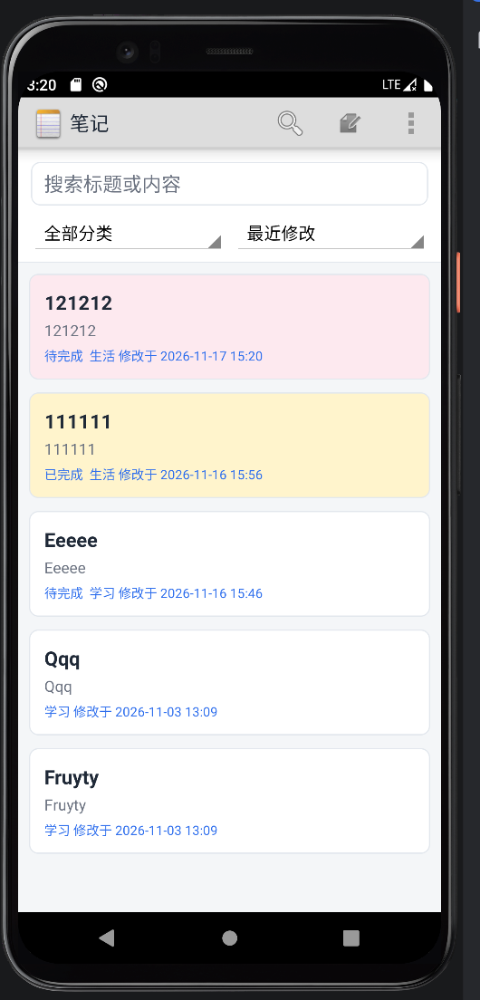
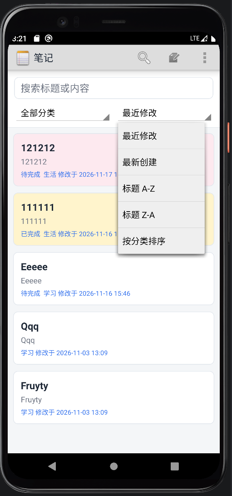
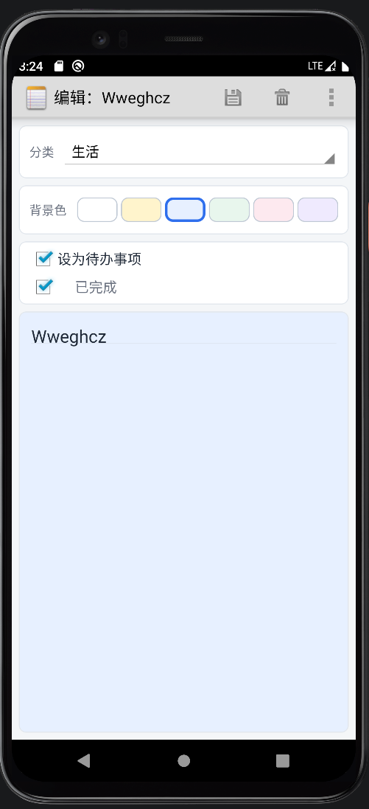
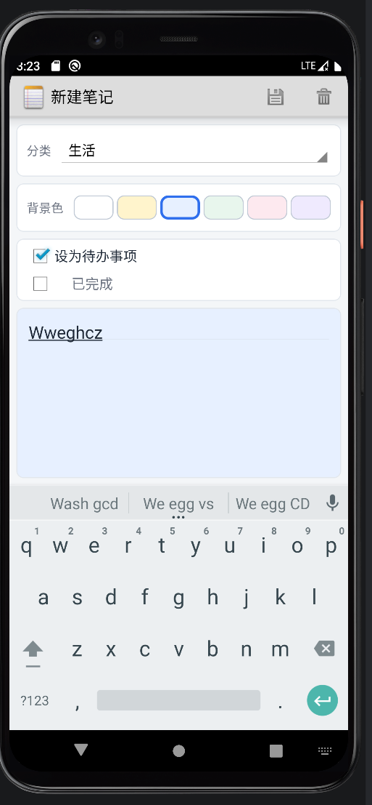
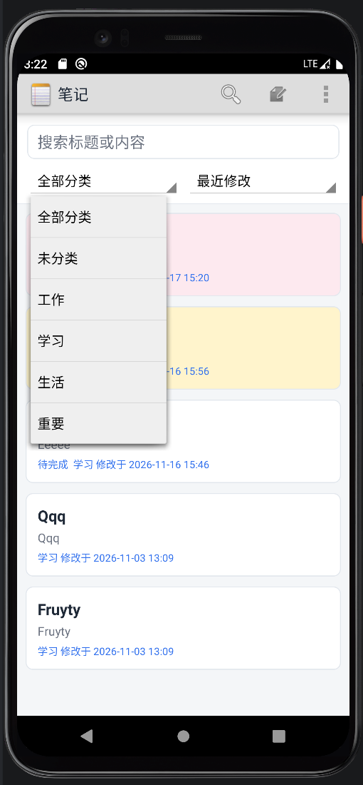
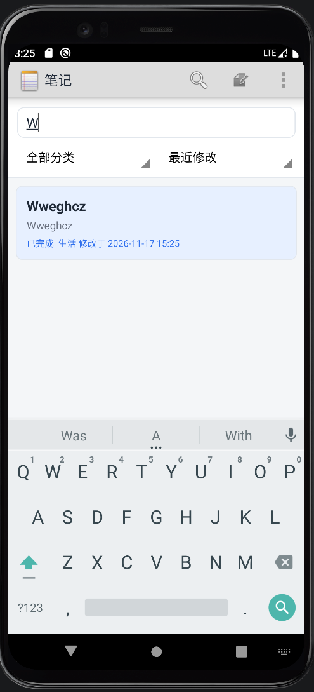

# NotePad

基于官方早期 NotePad 示例扩展的 Android 记事本应用，使用
`ListActivity + ContentProvider + SQLite` 实现笔记的保存、查询和管理。

## 已完成功能

- 笔记列表显示标题、正文摘要、分类和最后修改时间。
- 支持按标题或正文实时查询，搜索结果会保留当前分类筛选条件。
- 支持“未分类、工作、学习、生活、重要”五种类别，可在编辑器中修改并在列表中筛选。
- 支持按最近修改、最新创建、标题升序、标题降序和分类排序。
- 支持为每条笔记单独选择白色、黄色、蓝色、绿色、粉色或淡紫色背景。
- 支持待办事项：普通笔记可设为待办，独立待办页面支持新建、勾选完成、
  恢复未完成、长按编辑或删除。
- 数据库从版本 2 升级到版本 5 时使用 `ALTER TABLE` 保留原有笔记。

## 操作入口

- 列表顶部：输入标题/正文关键字搜索，右侧下拉框筛选分类。
- 列表菜单：新建、待办事项、搜索。
- 列表筛选栏：按分类筛选，并选择笔记排序方式。
- 长按笔记：打开、复制或删除。
- 编辑页面：选择分类和笔记背景色，可设为待办并标记完成。
- 待办页面：点击复选框切换完成状态，点击条目编辑内容，长按进行更多操作。

## 功能截图

所有功能截图保存在 `screenshot` 文件夹。

### 简洁 UI 界面

笔记以浅色卡片展示标题、正文摘要、分类、待办状态和修改时间。

### 笔记排序

支持最近修改、最新创建、标题 A-Z、标题 Z-A 和按分类排序。

### 待办完成状态

待办创建后可以切换完成和未完成状态，已完成条目标题会显示删除线。

### 背景色与待办设置

创建或编辑笔记时，可以选择背景色、分类、待办状态并填写正文内容。

### 笔记分类

创建笔记时可以设置分类，之后可以在列表顶部按分类筛选。

### 关键词搜索

输入标题或正文关键词后，列表会实时显示匹配的笔记。

## 构建

项目使用 Gradle 8.13 和 Android Gradle Plugin 8.12.2，编译 SDK 为 36，
最低支持 Android 3.0（API 11）。在 Android Studio 中同步后运行 `app` 即可。
